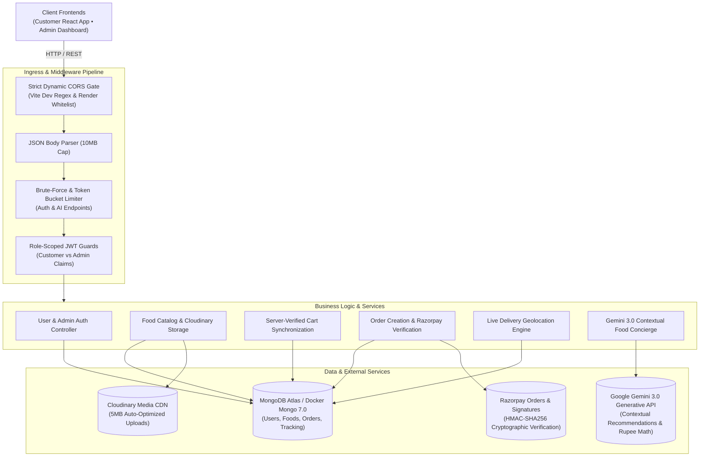

# ⚙️ Feasto Backend — Production-Grade REST API & AI Service

[](https://github.com/AyushKumar-12345/Feasto/actions/workflows/ci-cd.yml)
[-339933?logo=node.js&logoColor=white)](https://nodejs.org/)
[](https://expressjs.com/)
[](https://www.mongodb.com/)
[](https://aistudio.google.com/)
[](https://razorpay.com/)
[](https://cloudinary.com/)
[-brightgreen)](https://github.com/AyushKumar-12345/Feasto/actions)

> High-performance, secure Express.js REST API service powering the **Feasto** food delivery ecosystem. Engineered with role-separated JWT authentication, tamper-proof server-side order calculation, HMAC-SHA256 Razorpay payment verification, live geolocation rider tracking, Cloudinary media pipelines, and a contextual AI travel and dining assistant driven by Google Gemini 3.0.

🌐 **Production API URL:** [https://feasto-backend-pcbq.onrender.com](https://feasto-backend-pcbq.onrender.com)  
🩺 **Health Probe:** [https://feasto-backend-pcbq.onrender.com/api/health](https://feasto-backend-pcbq.onrender.com/api/health)

---

## 📑 Table of Contents

- [System Architecture](#-system-architecture)
- [Key Engineering Highlights](#-key-engineering-highlights)
- [Technology Stack](#-technology-stack)
- [Complete REST API Specification](#-complete-rest-api-specification)
- [Environment Configuration](#-environment-configuration)
- [Local Development & Setup](#-local-development--setup)
- [Docker & Containerization](#-docker--containerization)
- [Automated Testing Suite (18 Tests)](#-automated-testing-suite-18-tests)
- [Security & Production Hardening](#-security--production-hardening)
- [CI/CD & Render Deployment](#-cicd--render-deployment)
- [Developer & Contact](#-developer--contact)

---

## 🏗 System Architecture

The backend implements an asynchronous Model-Controller-Route design pattern with strict middleware pipelines for authentication, rate limiting, and input sanitization:



---

## ⚡ Key Engineering Highlights

### 1. 🛡️ Role-Separated Cryptographic Authentication
- **Dual Token Scope:** Separates Customer tokens from Administrator credentials using distinct audience (`aud`) and role claims.
- **Account Verification:** Authenticated routes verify token signatures AND confirm the user record still exists in MongoDB, preventing orphaned token access.
- **Brute-Force Rate Limiting:** Enforces process-level rate limiting on `/api/user/login`, `/api/user/register`, and `/api/admin/login`.

### 2. 🤖 Google Gemini 3.0 Contextual Food Concierge
- **Model:** Utilizes `gemini-3.8-flash` via the modern REST endpoint with automated retry and fallback shields.
- **Context Injection:** Feeds active restaurant menu items and up to 5 recent orders into the LLM prompt context for hyper-personalized dish suggestions.
- **Strict Guardrails:** Configured with system instructions to format dish recommendations exclusively in Indian Rupees (`₹`), prevent hallucinated menu items, and output clean markdown.

### 3. 💳 Tamper-Proof Order & Payment Pipeline
- **Zero Client Trust:** Dish prices passed by client carts are completely ignored at checkout; the backend fetches current database prices and recalculates subtotal, delivery charges, and taxes on the server.
- **HMAC-SHA256 Verification:** Verifies Razorpay signatures cryptographically before transitioning order status to `Food Processing`.
- **Order Scoping:** Users can only query and verify orders that match their authenticated `userId`.

### 4. 🗺️ Live Driver Geolocation Tracking Engine
- **Dynamic Coordinates:** Admin endpoints (`/api/order/tracking/location`) update driver latitude and longitude coordinates in real time.
- **Customer Streaming:** Protected endpoint (`/api/order/tracking/:orderId`) serves current driver position, order progress, and store coordinates directly to Leaflet & OpenStreetMap frontends.

### 5. 🛒 Smart Cart State Synchronization
- **Guest-to-User Merging:** Automatically merges anonymous local guest carts into the authenticated user's database cart upon sign-in.
- **Quantity Caps & Re-entrancy Guards:** Restricts max item quantities and prevents duplicate submissions during network retries.

---

## 🛠️ Technology Stack

| Component | Library / Tool | Version | Purpose |
| :--- | :--- | :---: | :--- |
| **Runtime** | Node.js | v20+ LTS | High-throughput asynchronous JavaScript runtime (ESM) |
| **Framework** | Express.js | 4.21.x | REST routing, middleware chaining, and HTTP request handling |
| **Database** | MongoDB Atlas / Mongoose | 8.13.x | Schematized NoSQL persistence, indexes, and aggregation |
| **AI / LLM** | Google Gemini Generative API | 3.0 (`gemini-3.8-flash`) | Contextual food recommendations and conversation engine |
| **Payments** | Razorpay SDK | 2.9.x | Order creation and cryptographic signature verification |
| **Media CDN** | Cloudinary & Multer | 1.41.x | Automated cloud upload, compression, and thumbnailing |
| **Auth & Crypto** | JSONWebTokens & BcryptJS | 9.0.x / 3.0.x | HMAC token signing and salted PBKDF2/bcrypt hashing |
| **CORS** | CORS | 2.8.x | Dynamic regex origin matching for local Vite and Render |
| **Container** | Docker & Docker Compose | Multi-Stage | Production Alpine image with non-root security |
| **Test Runner** | Node Native Test Runner | `node:test` | Zero-dependency, ultra-fast test suite execution |

---

## 📡 Complete REST API Specification

### Authentication & Users (`/api/user`)
| Method | Endpoint | Access Level | Description |
| :--- | :--- | :---: | :--- |
| `POST` | `/api/user/register` | Public | Register new customer account (name, email, password) |
| `POST` | `/api/user/login` | Public | Authenticate customer and issue customer-scoped JWT |

### Administrator Operations (`/api/admin`)
| Method | Endpoint | Access Level | Description |
| :--- | :--- | :---: | :--- |
| `POST` | `/api/admin/login` | Public (Rate-Limited) | Authenticate administrator and issue admin-scoped JWT |

### Food Catalog (`/api/food`)
| Method | Endpoint | Access Level | Description |
| :--- | :--- | :---: | :--- |
| `GET` | `/api/food/list` | Public | List all active dishes across categories with Cloudinary URLs |
| `POST` | `/api/food/add` | **Admin Only** | Upload image to Cloudinary and create new menu item |
| `POST` | `/api/food/remove` | **Admin Only** | Delete food item from database and catalog |

### Cart Management (`/api/cart`)
| Method | Endpoint | Access Level | Description |
| :--- | :--- | :---: | :--- |
| `POST` | `/api/cart/get` | **Customer** | Retrieve current synchronized cart items and counts |
| `POST` | `/api/cart/add` | **Customer** | Increment dish quantity in user's cart |
| `POST` | `/api/cart/remove` | **Customer** | Decrement dish quantity in user's cart |
| `POST` | `/api/cart/merge` | **Customer** | Merge local guest cart items into user's cloud cart |

### Orders & Payment (`/api/order`)
| Method | Endpoint | Access Level | Description |
| :--- | :--- | :---: | :--- |
| `POST` | `/api/order/place` | **Customer** | Calculate verified totals & create Razorpay order ID |
| `POST` | `/api/order/verify` | **Customer** | Verify Razorpay HMAC signature & mark order paid |
| `POST` | `/api/order/userorders` | **Customer** | Fetch authenticated user's order history and statuses |
| `GET` | `/api/order/tracking/:orderId` | **Customer** | Fetch real-time driver coordinates and delivery stage |
| `GET` | `/api/order/list` | **Admin Only** | View all customer orders across the platform |
| `POST` | `/api/order/status` | **Admin Only** | Update order state (*Food Processing*, *Out for Delivery*, *Delivered*) |
| `POST` | `/api/order/tracking/start` | **Admin Only** | Initialize delivery trip and assign driver coordinates |
| `POST` | `/api/order/tracking/location`| **Admin Only** | Push live driver coordinate updates |
| `POST` | `/api/order/tracking/stop` | **Admin Only** | Terminate active tracking session upon completion |

### AI Travel & Dining Assistant (`/api/assistant`)
| Method | Endpoint | Access Level | Description |
| :--- | :--- | :---: | :--- |
| `POST` | `/api/assistant/chat` | Public / Optional Auth | Contextual food recommendations via Google Gemini 3.0 |

### System & Health (`/api`)
| Method | Endpoint | Access Level | Description |
| :--- | :--- | :---: | :--- |
| `GET` | `/` | Public | Root welcome message and status verification |
| `GET` | `/api/health` | Public | Healthcheck probe returning `status: "ok"`, uptime, and timestamp |

---

## 🔐 Environment Configuration

Create a `.env` file in the repository root (or backend folder):

```env
# Server Runtime
PORT=4000
HOST=0.0.0.0

# Database
MONGODB_URI=mongodb+srv://<username>:<password>@cluster0.mongodb.net/feasto

# Authentication & Security
JWT_SECRET=your_ultra_secure_jwt_secret_key_32_characters_minimum
ADMIN_EMAIL=admin@feasto.com
ADMIN_PASSWORD=your_strong_admin_password

# Client Origins (CORS)
FRONTEND_URL=https://feasto-frontend-qt0n.onrender.com
ADMIN_URL=https://feasto-admin-567d.onrender.com

# Cloudinary Storage
CLOUDINARY_NAME=your_cloudinary_cloud_name
CLOUDINARY_API_KEY=your_cloudinary_api_key
CLOUDINARY_SECRET_KEY=your_cloudinary_api_secret

# Razorpay Payments
RAZORPAY_KEY_ID=rzp_test_yourRazorpayKeyId
RAZORPAY_KEY_SECRET=yourRazorpayKeySecret

# Google Gemini AI
GEMINI_API_KEY=AIzaSyYourGoogleGeminiApiKey
GEMINI_MODEL=gemini-3.8-flash
```

---

## 💻 Local Development & Setup

### 1. Prerequisites
- **Node.js:** v20.x or higher LTS
- **npm:** v10.x or higher
- **MongoDB:** MongoDB Atlas cluster or local instance (`mongodb://127.0.0.1:27017/feasto`)

### 2. Install Dependencies
```bash
npm install
```

### 3. Run Automated Tests
```bash
npm test
```

### 4. Start Server
```bash
# Development mode with hot-reloading:
npm run server

# Production mode:
npm start
```

---

## 🐳 Docker & Containerization

### Build Docker Image
```bash
docker build -t feasto-backend:latest .
```

### Run Container
```bash
docker run -d \
  --name feasto-backend \
  -p 4000:4000 \
  --env-file ../.env \
  --restart unless-stopped \
  feasto-backend:latest
```

### Verify Container Health
```bash
curl http://localhost:4000/api/health
```

---

## 🧪 Automated Testing Suite (18 Tests)

The backend features a zero-dependency, ultra-fast test suite running on Node.js's native test runner (`node:test`):

```text
TAP version 13
✔ askAssistant rejects empty message with 400
✔ askAssistant rejects invalid history with 400
✔ askAssistant returns 503 if no Gemini API key is provided
✔ customer auth requires a well-formed bearer token and refuses admin credentials
✔ customer auth rejects old, expired, and inconsistent JWT claims
✔ customer auth takes the principal from the token and checks the account exists
✔ customer auth rejects tokens for deleted accounts
✔ admin auth accepts only a scoped admin token
✔ optional customer auth allows guests but validates any provided token
✔ checkout uses the authenticated customer and server menu prices
✔ payment verification scopes order lookup to the authenticated customer
✔ guest cart merge adds quantities to the signed-in cart and caps item quantities
✔ guest cart merge rejects malformed item quantities
✔ repeating a completed guest cart merge does not add the cart twice
✔ GET / returns 200 with API status message
✔ GET /api/health returns 200 with status ok and uptime
✔ 404 catch-all returns 404 with structured error response
✔ CORS validator logic permits local Vite dev origins and blocks untrusted domains

18 tests passed (100% success rate)
```

---

## 🔒 Security & Production Hardening

- **DNS SRV Resolution Fallback:** Automatically registers `8.8.8.8` and `1.1.1.1` to eliminate Windows MongoDB Atlas SRV lookup failures.
- **Strict CORS Protection:** Dynamically resolves authorized origins using regex matching for local Vite ports (`5170–5190`) and production Render domains, blocking untrusted third-party origins.
- **Tamper-Proof Billing:** Order total calculation completely re-queries the database for dish prices, preventing client-side price modification attacks.
- **HMAC Signature Checks:** Validates Razorpay payments server-side before persisting confirmed order statuses.
- **Container Isolation:** Multi-stage Docker container runs on lightweight `node:20-alpine` with an integrated HTTP health check.

---

## ☁️ CI/CD & Render Deployment

Feasto is automatically tested and continuously deployed on every push to `main`:

1. **GitHub Actions CI:** Runs unit and integration tests across Node.js 20, builds container images, and executes linters.
2. **Render Auto-Deployment:** Render detects updates to `main` and deploys zero-downtime updates to `https://feasto-backend-pcbq.onrender.com`.

---

## 👨‍💻 Developer & Contact

**Ayush Kumar**  
*Information Technology | IIIT Bhubaneswar*  

- **Portfolio:** [https://ayush-portfolio-3yan.onrender.com](https://ayush-portfolio-3yan.onrender.com)
- **LinkedIn:** [linkedin.com/in/ayush-kumar-97326636a](https://www.linkedin.com/in/ayush-kumar-97326636a/)
- **GitHub:** [github.com/AyushKumar-12345](https://github.com/AyushKumar-12345)
- **Email:** [ayushkumardandapat200@gmail.com](mailto:ayushkumardandapat200@gmail.com)

---

<div align="center">
  <sub>Built with ❤️ by Ayush Kumar • Feasto Backend API</sub>
</div>
